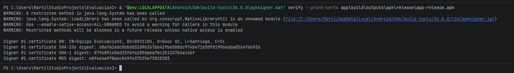

# Gestión de oportunidades y activaciones corporativas

App móvil Android (Kotlin + Jetpack Compose) para identificar, registrar, priorizar y dar seguimiento a oportunidades de activación corporativa: eventos, ferias, organizaciones, contactos y resultados.

Proyecto de **DSY1105 – Desarrollo de Aplicaciones Móviles**, Evaluación Parcial 4 (Caso 007D).

## Integrantes

- Martin Jaque
- Liza Micele

## Repositorios

| Componente | Repositorio |
|---|---|
| App móvil (este repo) | https://github.com/M4rtinj4ke1/Evaluacion2 |
| Microservicio Spring Boot | https://github.com/lizatamara/api-oportunidades |

## Funcionalidades

- Inicio de sesión con cuenta ficticia y validación de campos
- **Oportunidades**: CRUD completo sincronizado con el microservicio propio (Spring Boot) y respaldo local en Room
- Filtros de oportunidades por estado y prioridad
- **Organizaciones y contactos**: CRUD con Room, selección de región y comuna, validación de correo y teléfono
- **Feriados de Chile**: consumo de una API externa con Retrofit, con filtro "Próximos / Todo el año"
- Cámara: foto de evidencia de la oportunidad
- Ubicación: coordenadas del lugar de la oportunidad
- Animaciones en transiciones, colores de prioridad y mensajes

## Arquitectura

**MVVM**: pantallas Compose (`ui`) → ViewModel (`StateFlow`) → Repository → Retrofit (`data/remote`) y Room (`data/local`).

```
ui/            Pantallas Compose + ViewModel + UiState por módulo
data/remote/   Retrofit: OportunidadApiService (microservicio) y FeriadoApiService (API externa)
data/local/    Room: entidades, DAOs y AppDatabase
data/repository/  Lógica de acceso a datos (API + Room)
```

## Endpoints utilizados

### Microservicio propio (Spring Boot + JPA) – `http://10.0.2.2:8080/`

| Método | Endpoint | Descripción |
|---|---|---|
| GET | `/api/oportunidades` | Lista todas las oportunidades (más nuevas primero) |
| GET | `/api/oportunidades/{id}` | Obtiene una oportunidad por id |
| POST | `/api/oportunidades` | Crea una oportunidad (201 Created) |
| PUT | `/api/oportunidades/{id}` | Actualiza una oportunidad |
| DELETE | `/api/oportunidades/{id}` | Elimina una oportunidad (204 No Content) |

### API externa – `https://api.boostr.cl/`

| Método | Endpoint | Descripción |
|---|---|---|
| GET | `/holidays.json` | Feriados de Chile del año (fecha, nombre, tipo, irrenunciable) |

## Pasos para ejecutar

### 1. Microservicio
1. Clonar `api-oportunidades` y abrir una terminal en la carpeta.
2. Usar Java 21 o superior (por ejemplo, el JBR de Android Studio):
   ```powershell
   $env:JAVA_HOME = "C:\Program Files\Android\Android Studio\jbr"
   ```
3. Levantar el servicio:
   - Con **H2** (no requiere instalar nada):
     ```powershell
     .\mvnw.cmd spring-boot:run "-Dspring-boot.run.profiles=h2"
     ```
   - Con **MySQL** (XAMPP encendido en el puerto 3306):
     ```powershell
     .\mvnw.cmd spring-boot:run
     ```
4. Verificar en el navegador: `http://localhost:8080/api/oportunidades`

### 2. App móvil
1. Abrir este proyecto en Android Studio y sincronizar Gradle.
2. Ejecutar en un **emulador** (la app usa `10.0.2.2` para llegar al `localhost` del PC).
   Para un teléfono físico, cambiar `BASE_URL` en `RetrofitClient.kt` por la IP local del PC.
3. Iniciar sesión con usuario `admin` y contraseña `123`.

> `targetSdk = 36`: Android 17 (API 37) bloquea por defecto el acceso a la red local sin el permiso `ACCESS_LOCAL_NETWORK`.

## Pruebas unitarias

- Herramientas: **JUnit 4**, **MockK** y **kotlinx-coroutines-test**.
- Ubicación: `app/src/test/java/com/example/evaluacion2/`
- Se mockean el `ApiService` (Retrofit) y los `DAO` (Room), así que las pruebas no dependen de la red ni de la base de datos.
- Cobertura de la capa lógica (ViewModels + Repositories): **98 % de líneas**.

```powershell
.\gradlew testDebugUnitTest                   # ejecutar pruebas
.\gradlew createDebugUnitTestCoverageReport   # reporte: app/build/reports/coverage/test/debug/index.html
```

## APK firmado

- APK: [`apk/Evaluacion2-release.apk`](apk/Evaluacion2-release.apk)
- Llave: [`keystore/evaluacion2.jks`](keystore/evaluacion2.jks) (alias `evaluacion2`, RSA 2048, validez 10.000 días)
- Configuración: `signingConfigs` en `app/build.gradle.kts`, que lee `keystore.properties`

Cómo se generó:
```powershell
keytool -genkeypair -v -keystore keystore\evaluacion2.jks -alias evaluacion2 -keyalg RSA -keysize 2048 -validity 10000
.\gradlew assembleRelease
apksigner verify --print-certs app\build\outputs\apk\release\app-release.apk
```



> Proyecto académico: el `.jks` y `keystore.properties` se incluyen porque lo exige la evaluación. En un proyecto real no se suben al repositorio.

## Planificación

- Trello: https://trello.com/invite/b/6aa9b125e035f77e79c4f9ad/ATTI4ceaa2ef355991dccf825eee48be43920FFE88AF/evparcial2
